# SwasthSetu

> A unified digital healthcare platform for Indian Government Hospitals — connecting citizens, doctors, and hospital staff through one secure care journey.

SwasthSetu brings patient sign-in, appointment booking, live OPD token queues, consultations, in-app notifications, lab reports, blood bank stock, and bed management into one modular application. The backend is an **Express.js + TypeScript** REST API on **PostgreSQL (Prisma)** and **Redis**; the frontend is a lightweight static portal written in HTML, CSS, and vanilla JavaScript.

**Live demo:** [https://swasthsetu-web.onrender.com](https://swasthsetu-web.onrender.com)

---

## Table of contents

- [Tech stack](#tech-stack)
- [System architecture](#system-architecture)
- [Portals and roles](#portals-and-roles)
- [User flows](#user-flows)
  - [Overall user journey](#1-overall-user-journey)
  - [Patient OTP login and registration](#2-patient-otp-login-and-registration)
  - [Staff login](#3-staff-login-doctor--hospital)
  - [Token refresh and logout](#4-token-refresh-and-logout)
  - [Appointment and OPD queue lifecycle](#5-appointment-and-opd-queue-lifecycle)
  - [End-to-end care journey](#6-end-to-end-care-journey)
  - [Hospital operations](#7-hospital-operations-labs-blood-beds)
- [Request lifecycle inside the API](#request-lifecycle-inside-the-api)
- [Data model](#data-model)
- [API reference](#api-reference)
- [Project structure](#project-structure)
- [Run locally](#run-locally)
- [Environment variables](#environment-variables)
- [Demo accounts](#demo-accounts)
- [Testing](#testing)
- [Deployment](#deployment)
- [Roadmap](#roadmap)

---

## Tech stack

| Layer | Technology |
| --- | --- |
| Frontend | HTML, CSS, vanilla JavaScript, served by a small Node.js static router (`scripts/serve-frontend.cjs`) |
| Backend | **Express.js 4**, TypeScript 5, Node.js 20 |
| Validation | Zod (request bodies and environment variables) |
| Database | PostgreSQL 16 with **Prisma ORM 5** (migrations + seed) |
| Cache / OTP store | Redis 7 (`redis` client) |
| Authentication | JWT access tokens (15 min) + rotating refresh tokens (7 days) in an `httpOnly` cookie, Argon2 hashing, role-based access control |
| Testing | Vitest + Supertest |
| Local infrastructure | Docker Compose (PostgreSQL + Redis) |
| Package manager | pnpm 9 (backend) |
| Hosting | Render (static web service, Express API, PostgreSQL, Key Value/Redis) |

> The backend was migrated from NestJS to plain Express. API paths and response shapes stayed the same, so the frontend did not need changes.

---

## System architecture

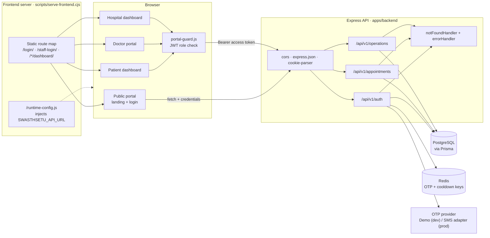

**How the pieces fit together**

- `server.ts` loads and validates the environment with Zod, connects Prisma and Redis, builds the services, and passes them into `createApp()`. Because services are injected, tests can run the app with fakes.
- `app.ts` registers the global middleware, a `/health` endpoint, three routers, and the shared 404 and error handlers.
- Each router uses `authenticate(jwt)` (except the public auth routes), `validateBody(zodSchema)`, and `asyncHandler()` so errors always reach the central error handler.
- Services hold the business logic and check roles. Routers stay thin.

---

## Portals and roles

| Portal | Route | Who signs in | What it does |
| --- | --- | --- | --- |
| Public website | `/` | Anyone | Landing page, hospital info, entry points to patient and staff login |
| Patient login | `/login/` | Patients | Mobile number + OTP, first-time registration |
| Staff login | `/staff-login/` | Doctors and hospital staff | Employee ID + password |
| Patient dashboard | `/patient/dashboard/` | `PATIENT` | Own appointments, live queue position, notifications, lab reports |
| Doctor portal | `/doctor/dashboard/` | `DOCTOR` | Today's OPD overview, assigned queue, start/complete consultations |
| Hospital dashboard | `/hospital/dashboard/` | `HOSPITAL_ADMIN`, `SUPER_ADMIN` | Create appointments, view patients/doctors, manage lab reports, blood stock, and beds |

### Role permissions enforced by the API

| Action | Allowed roles |
| --- | --- |
| Create appointment | `SUPER_ADMIN`, `HOSPITAL_ADMIN`, `RECEPTION` |
| Start / complete consultation | `DOCTOR` (own patients only), `SUPER_ADMIN`, `HOSPITAL_ADMIN` |
| List patients | `SUPER_ADMIN`, `HOSPITAL_ADMIN`, `RECEPTION`, `DOCTOR` |
| List doctors | `SUPER_ADMIN`, `HOSPITAL_ADMIN`, `RECEPTION` |
| Update lab reports, blood stock, beds | `SUPER_ADMIN`, `HOSPITAL_ADMIN`, `LAB_STAFF`, `BLOOD_BANK_STAFF`, `BED_MANAGER` |
| View own appointments, queue, notifications | Every signed-in user (results are scoped to the user) |

Data is scoped automatically: a patient sees only their own records, a doctor sees only appointments assigned to them, and staff see records for their `hospitalId`.

> The schema also defines `ACCOUNTS` and `VIEWER` roles for future use. The frontend portal guard currently opens the hospital dashboard only for `HOSPITAL_ADMIN` and `SUPER_ADMIN`.

---

## User flows

### 1. Overall user journey

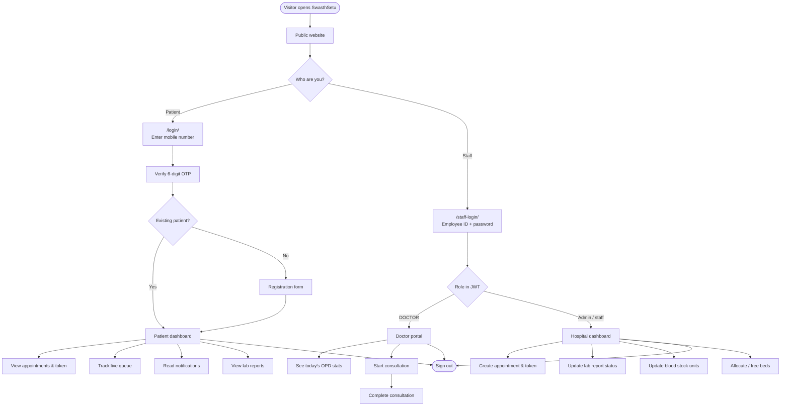

### 2. Patient OTP login and registration

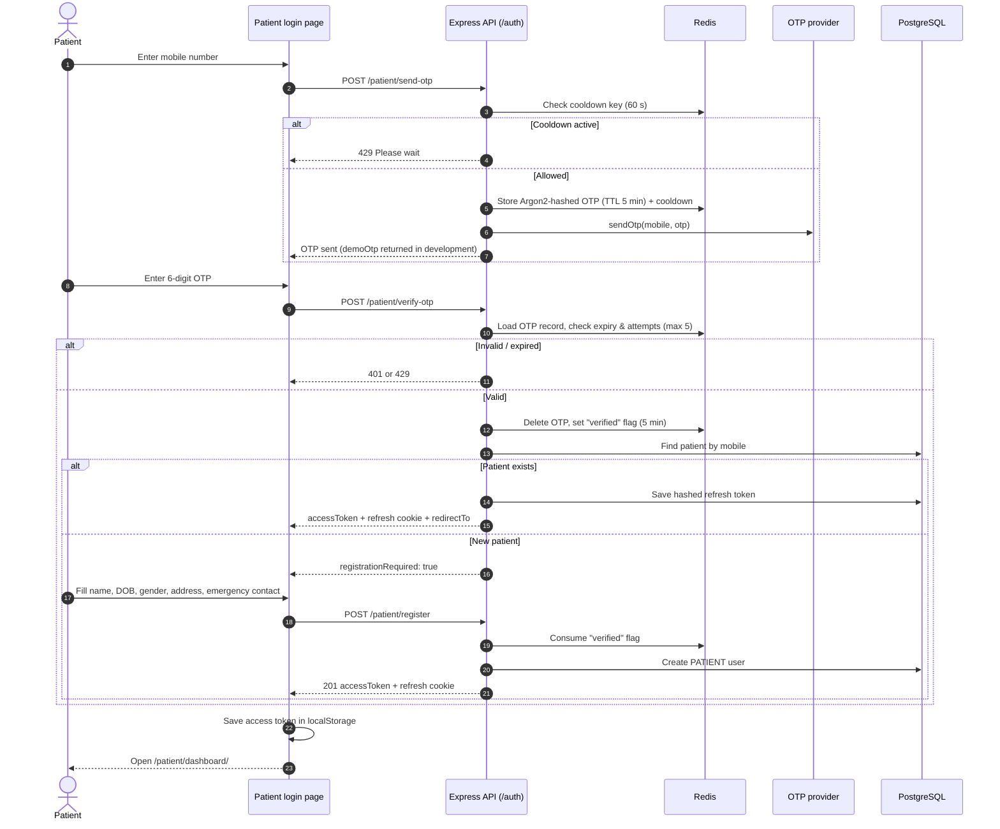

### 3. Staff login (doctor / hospital)

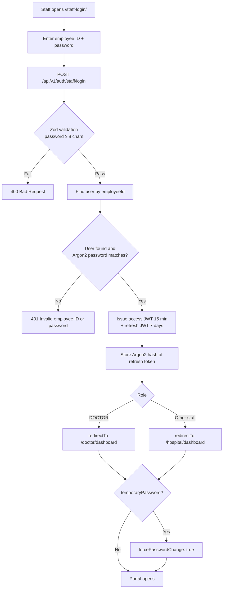

### 4. Token refresh and logout

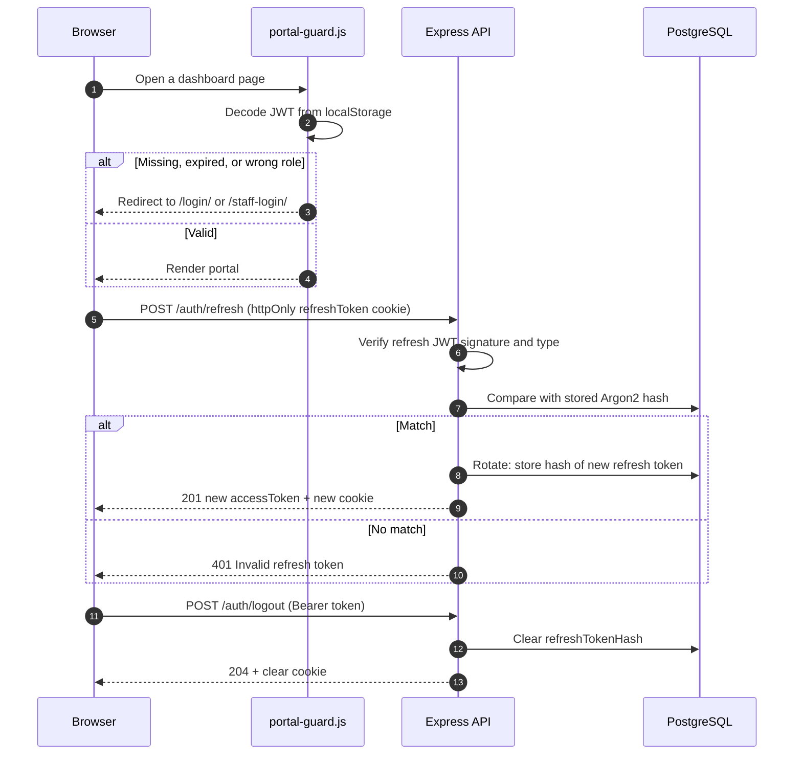

### 5. Appointment and OPD queue lifecycle

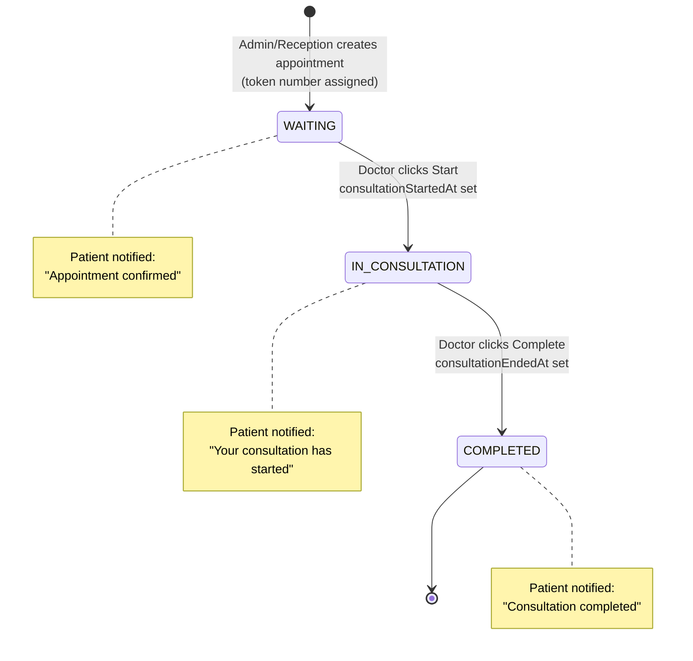

The live queue (`GET /appointments/queue`) shows every appointment that is `WAITING` or `IN_CONSULTATION`, ordered by token number. `CONFIRMED` and `CANCELLED` exist in the schema for future scheduling features.

**How token numbers work:** when an appointment is created, the API finds the highest token for that hospital and time slot and adds one. The first token in a slot is 41.

### 6. End-to-end care journey

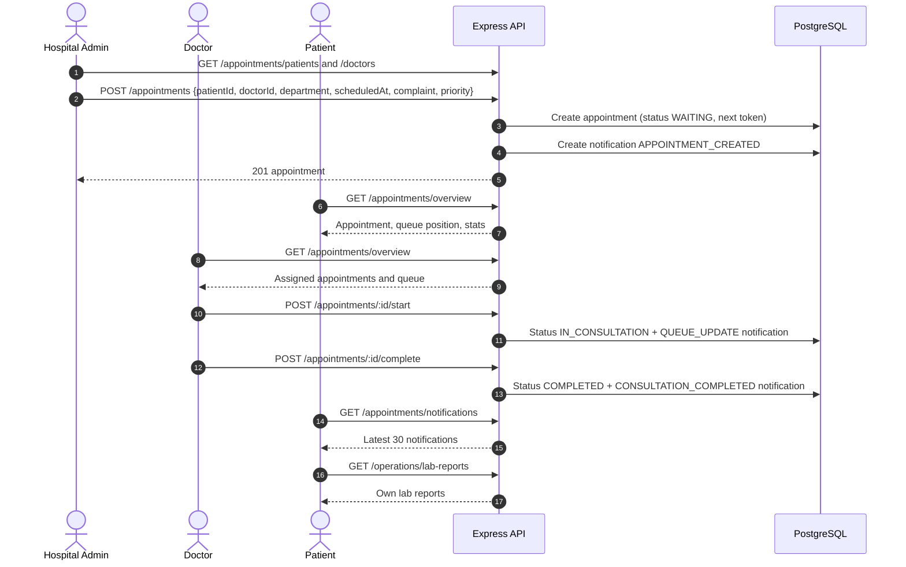

### 7. Hospital operations (labs, blood, beds)

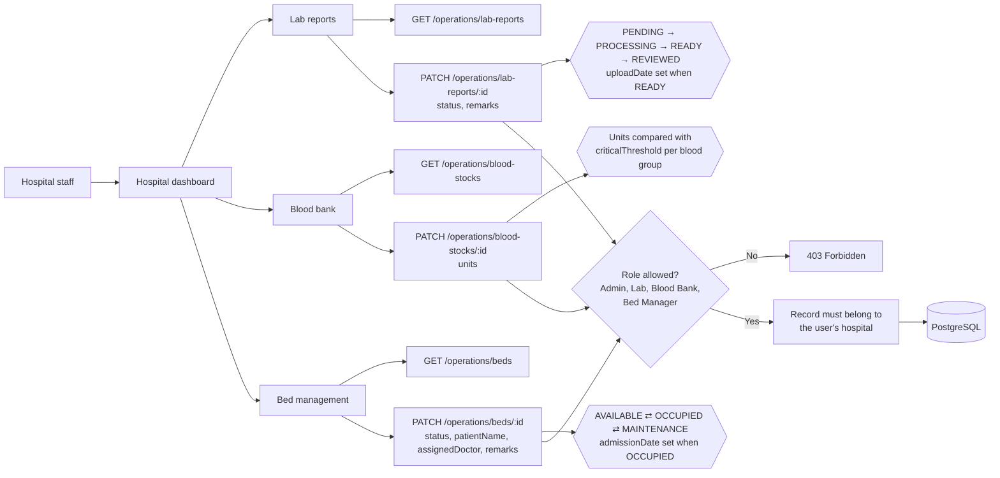

---

## Request lifecycle inside the API

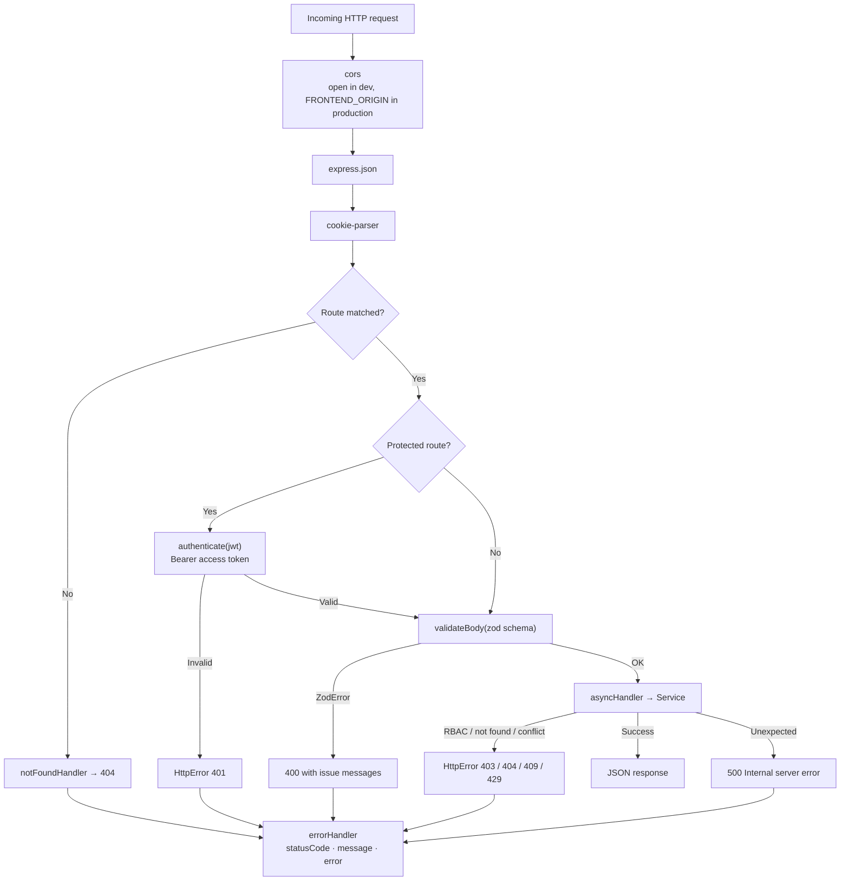

Every error has the same JSON shape:

```json
{ "statusCode": 404, "message": "Appointment not found.", "error": "Not Found" }
```

---

## Data model

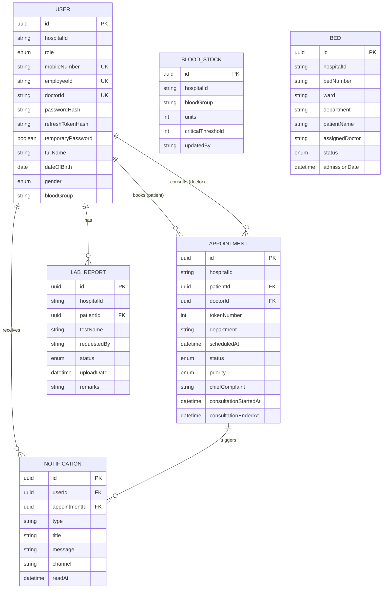

**Enums:** `Role` (PATIENT, DOCTOR, SUPER_ADMIN, HOSPITAL_ADMIN, RECEPTION, LAB_STAFF, BLOOD_BANK_STAFF, BED_MANAGER, ACCOUNTS, VIEWER) · `AppointmentStatus` · `AppointmentPriority` (NORMAL, HIGH, EMERGENCY) · `LabReportStatus` · `BedStatus` · `Gender`.

---

## API reference

Base URL: `http://127.0.0.1:3000/api/v1` · 🔒 = requires `Authorization: Bearer <accessToken>`

### Health

| Method | Path | Description |
| --- | --- | --- |
| GET | `/health` | Returns `{ "status": "ok" }` (no `/api/v1` prefix) |

### Auth — `/auth`

| Method | Path | Body | Description |
| --- | --- | --- | --- |
| POST | `/patient/send-otp` | `{ mobileNumber }` | Send a 6-digit OTP (60 s cooldown, 5 min expiry) |
| POST | `/patient/verify-otp` | `{ mobileNumber, otp }` | Log in, or return `registrationRequired: true` |
| POST | `/patient/register` | `{ mobileNumber, fullName, dateOfBirth, gender, address, bloodGroup?, emergencyContact }` | Create a patient after OTP verification |
| POST | `/staff/login` | `{ employeeId, password }` | Doctor and staff login |
| POST | `/refresh` | refresh cookie | Rotate tokens and return a new access token |
| POST 🔒 | `/logout` | — | Revoke the refresh token and clear the cookie |

### Appointments — `/appointments` 🔒

| Method | Path | Description |
| --- | --- | --- |
| GET | `/` | Appointments for the current user |
| GET | `/queue` | Live queue (WAITING + IN_CONSULTATION) |
| GET | `/overview` | Appointments + queue + stats (total, completed, waiting, inConsultation) |
| GET | `/patients` | Up to 50 patients (staff and doctors) |
| GET | `/doctors` | Doctors in the user's hospital |
| GET | `/notifications` | Latest 30 notifications for the user |
| POST | `/` | Create an appointment `{ patientId, doctorId, department, scheduledAt, chiefComplaint, priority? }` |
| POST | `/:id/start` | Move to IN_CONSULTATION |
| POST | `/:id/complete` | Move to COMPLETED |

### Operations — `/operations` 🔒

| Method | Path | Body | Description |
| --- | --- | --- | --- |
| GET | `/lab-reports` | — | Patient: own reports · Staff: hospital reports |
| PATCH | `/lab-reports/:id` | `{ status?, remarks? }` | Update report status or remarks |
| GET | `/blood-stocks` | — | Blood stock by group |
| PATCH | `/blood-stocks/:id` | `{ units }` | Set available units |
| GET | `/beds` | — | Beds in the hospital |
| PATCH | `/beds/:id` | `{ status?, patientName?, assignedDoctor?, remarks? }` | Allocate, free, or mark a bed for maintenance |

---

## Project structure

```text
swasthsetu/
├── apps/
│   ├── backend/                      # Express.js + TypeScript API
│   │   ├── prisma/
│   │   │   ├── schema.prisma         # Data model
│   │   │   ├── migrations/           # SQL migrations
│   │   │   └── seed.ts               # Demo hospital, staff, patients, beds, blood, labs
│   │   ├── src/
│   │   │   ├── server.ts             # Bootstrap: env, Prisma, Redis, DI, graceful shutdown
│   │   │   ├── app.ts                # Express app factory: middleware + routers
│   │   │   ├── app.test.ts           # Supertest API tests
│   │   │   ├── config/env.ts         # Zod-validated environment
│   │   │   ├── common/               # asyncHandler, validateBody, HttpError, error handlers
│   │   │   ├── cache/                # Redis and in-memory key-value stores
│   │   │   ├── database/             # PrismaService + auth user repository
│   │   │   └── modules/
│   │   │       ├── auth/             # Routes, JWT, OTP, Argon2, providers, middleware
│   │   │       ├── appointments/     # Booking, queue, consultation, notifications
│   │   │       ├── operations/       # Lab reports, blood stock, beds
│   │   │       └── …                 # Reserved folders for future domain modules
│   │   ├── docker-compose.yml        # PostgreSQL (6543) + Redis (6379)
│   │   └── .env.example
│   └── web/                          # Static frontend
│       ├── public/                   # Landing + login route pages
│       └── src/
│           ├── public-portal/        # Landing and auth scripts/styles
│           ├── patient-portal/       # Patient dashboard
│           ├── doctor-portal/        # Doctor OPD workspace
│           ├── hospital-portal/      # Hospital operations dashboard
│           └── shared/               # portal-guard.js, internal-app.js, shared styles
├── docs/                             # Architecture, auth, features, folder structure
├── scripts/serve-frontend.cjs        # Frontend static router + runtime API config
├── DEMO.md
└── package.json
```

---

## Run locally

### Prerequisites

- Node.js 20
- pnpm 9 (`corepack enable` sets this up)
- Docker Desktop

### 1. Start PostgreSQL and Redis

```bash
cd apps/backend
docker compose up -d
```

### 2. Configure and start the API

```bash
cp .env.example .env
pnpm install
pnpm prisma:migrate
pnpm prisma:seed
pnpm start:dev
```

`start:dev` runs the API with `tsx watch` at `http://127.0.0.1:3000/api/v1`. For a production-style run, use `pnpm build` and then `pnpm start`.

### 3. Start the frontend

From the repository root:

```bash
npm run frontend
```

Open [http://127.0.0.1:4173](http://127.0.0.1:4173).

### Useful scripts

| Command | Where | What it does |
| --- | --- | --- |
| `pnpm start:dev` | `apps/backend` | Run the API with hot reload |
| `pnpm build` / `pnpm start` | `apps/backend` | Compile to `dist/` and run |
| `pnpm test` | `apps/backend` | Run Vitest tests |
| `pnpm typecheck` | `apps/backend` | Type-check without emitting files |
| `pnpm prisma:migrate` | `apps/backend` | Apply migrations |
| `pnpm prisma:seed` | `apps/backend` | Load demo data |
| `pnpm demo:reset` | `apps/backend` | Reset the database and reseed |
| `npm run frontend` | root | Serve the frontend on port 4173 |
| `npm run backend` | root | Shortcut for `pnpm start:dev` in the backend |

---

## Environment variables

### Backend (`apps/backend/.env`)

| Variable | Default | Description |
| --- | --- | --- |
| `NODE_ENV` | `development` | `development`, `test`, or `production`. Production uses the SMS OTP provider, secure cookies, and strict CORS |
| `PORT` | `3000` | API port |
| `FRONTEND_ORIGIN` | `http://127.0.0.1:4173` | Allowed CORS origin in production |
| `DATABASE_URL` | — | PostgreSQL connection string (local Docker uses port `6543`) |
| `REDIS_URL` | — | Redis connection string |
| `JWT_ACCESS_SECRET` | — | Secret for 15-minute access tokens |
| `JWT_REFRESH_SECRET` | — | Different secret for 7-day refresh tokens |

The API checks these variables with Zod at startup and stops with a clear message if any are missing or invalid.

### Frontend server

| Variable | Default | Description |
| --- | --- | --- |
| `FRONTEND_PORT` / `PORT` | `4173` | Port for the static server |
| `SWASTHSETU_API_URL` | `http://127.0.0.1:3000/api/v1` | API base URL, served to the browser through `/runtime-config.js` |

---

## Demo accounts

Run `pnpm prisma:seed` first.

| Role | Login | Password / method |
| --- | --- | --- |
| Hospital Admin | `HA-1001` | `ChangeMe123!` |
| Doctor | `DR-1001` (also `DR-1002`, `DR-1003`) | `ChangeMe123!` |
| Patient | `9000000001` | Request an OTP. In development the OTP is shown in the response and the API log |

### Suggested demo

1. Log in as **Hospital Admin**, then create an appointment for a patient with `DR-1001`.
2. Log in as **Doctor**, then start and complete that consultation from the live queue.
3. Log in as **Patient** `9000000001` to see the updated appointment, notifications, and lab reports.

See [DEMO.md](DEMO.md) for the full walkthrough.

---

## Testing

```bash
cd apps/backend
pnpm test
```

- `src/app.test.ts` — Supertest API contract tests using injected fake services: health check, patient OTP response, Zod validation and malformed JSON, staff login with the refresh cookie, protected routes, and the 404 error shape.
- `src/modules/auth/services/otp.service.test.ts` — OTP issue/verify and resend cooldown, using the in-memory key-value store.

---

## Deployment

SwasthSetu runs on **Render** as four services:

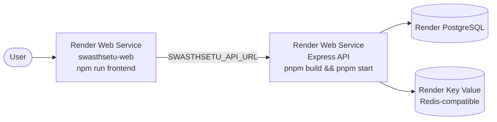

For production, set `NODE_ENV=production`, use strong and different JWT secrets, set `FRONTEND_ORIGIN` to the web service URL, and set `SWASTHSETU_API_URL` on the frontend service to the API URL.

---

## Roadmap

- Connect a real SMS provider (MSG91, Twilio, or Textlocal) in `SmsProvider`. Right now it throws an error in production until it is configured.
- Send notifications over WhatsApp. They are currently stored in the app only (`channel = IN_APP`).
- Add API endpoints for prescriptions, medical history, and full doctor and hospital management. The reserved module folders are already in place.
- Add a password-change flow for staff accounts that have `temporaryPassword`.
- Add live queue updates with WebSockets or server-sent events.

## Documentation

- [Architecture](docs/ARCHITECTURE.md)
- [Authentication flow](docs/AUTHENTICATION.md)
- [Features](docs/FEATURES.md)
- [Folder structure](docs/FOLDER_STRUCTURE.md)
- [Demo guide](DEMO.md)
